# Vision



Golem today is one daemon on your Mac, with a chat in your terminal and in your browser. This page says where golem goes from there, and why. It does not say when.

**A vision, not a plan.** Nothing here is built yet. The [roadmap](roadmap.md) links the issues that hold the work, step by step. When a part of this page becomes work, it moves there, and its choices get an ADR in [adr/](adr/README.md).

## What golem becomes

Your own agent, on hardware you choose. It does real work with small local models, and pays for a big hosted one only when that pays off. It learns from what it does. It keeps working when you walk away, splits big jobs into small ones, and asks you only when it matters, wherever you are. And the same agent you shaped on your laptop can be the agent behind your application.

Five ideas carry it:

| | Idea | In one line |
|---|---|---|
| 1 | [One daemon, many doors](#one-daemon-one-protocol-many-doors) | Every client speaks one protocol to one daemon. Everything that faces a network lives in one gateway |
| 2 | [Golem everywhere you are](#golem-everywhere-you-are) | A native app family for the Mac and the iPhone, built once in SwiftUI |
| 3 | [Workflows](#workflows-golem-works-while-you-are-away) | Work that runs on its own, survives a crash, waits for you, and acts once |
| 4 | [Sub-agents](#sub-agents-one-golem-many-hands) | Golem hands parts of a task to smaller agents, each with its own brief and model |
| 5 | [Serve mode](#serve-mode-the-agent-behind-your-app) | The agent deployed behind an app, with the models kept strictly outside |

They stand on [a core that keeps growing](#the-core-keeps-growing): skills, memory, local models, routing and cost, evals.

---

## One daemon, one protocol, many doors


Phones, apps, and other golems all need to reach golem over a network. The question is how to do that without making golem complicated.

**The socket stays.** The daemon listens on a Unix socket, and only there. The protocol is the contract; the socket is only one way to carry it.

**Everything that faces a network is the gateway.** The gateway is a part of the `golem` binary ([ADR-028](adr/028-web-gateway.md)). It opens the doors a given setup needs, checks who is knocking, and passes each connection on to the daemon's socket. The web UI already works this way.

- **The daemon does not change.** No ports, no TLS, no logins. "The file's mode is the login" stays true inside every machine.
- **Network security lives in one place.** Tokens, pairing, `Origin` checks, and rate limits are one program, next to the client library.
- **The simplest remote link needs no gateway.** OpenSSH can forward a Unix socket, so one golem can attach to another over `ssh`.

**Two APIs, on purpose.** Golem's own clients (the terminal, the web UI, the native apps, a parent golem) speak the full golem protocol, which keeps changing. Applications get a small, stable **app API**: start a run, follow its events, answer an approval, and the familiar `/v1/chat/completions`. The gateway translates. Keeping them apart lets the protocol grow without breaking anyone's app.

**One release, different modes.** The same build runs as your *personal* golem (started by launchd), as a *child* started by another golem, or in *serve* mode behind an app. A mode is a setting, not a new code path.

---

## Golem everywhere you are


The terminal is where golem is built. The [web UI](architecture/web.md) is where it is easiest to read. The native apps are where golem *finds you*: on the menu bar while you work, on your lock screen when you are away.

**One app family, in SwiftUI.** The Mac app and the iPhone app are one codebase. A shared Swift package, GolemKit, holds the protocol types (written by `just gen` from the same schemas as the Python and TypeScript ones), the connection with its resume-from-`seq`, and the view state that turns events into a transcript. Each app adds only what its device does best. A native app is a second UI written screen by screen, and that only pays off because one codebase covers both devices.

### On the Mac

- **A menu bar golem:** is the daemon up, what is running, what today has cost.
- **Notifications you answer:** Allow and Deny on an approval, without opening anything.
- **A global hotkey** for a quick "ask golem" window, like Spotlight.
- **Drop anything on it:** a file, a folder, a screenshot, a link.
- **Runs and sub-agents as a timeline** you can click into (see [below](#seeing-it-work)).

### On the iPhone

The phone is not a small terminal. It is where you **watch and decide** while you are away.

- **Approve from the lock screen,** with the command or the diff in front of you, and Face ID for anything risky.
- **Watch a run** in a Live Activity: "golem · running tests · step 4 of 9".
- **Start work:** pick a recent project, type or dictate a task, or start a workflow.
- **Send things to golem** from the share sheet, and ask it through Siri and Shortcuts.

### How the phone reaches the Mac

A phone on 5G cannot call a Mac behind a home router, and iOS freezes apps in the background. So the phone reaches golem in one of three ways: the same Wi-Fi (the gateway announces itself with Bonjour), a private network such as Tailscale, or a small **relay** that both sides connect out to, which also sends the push notifications. Pairing once with a QR code gives the phone and the Mac each other's keys, so the relay only ever forwards encrypted bytes, and keeps nothing. If it is down, nothing is lost: the event log replays when the phone gets through.

While a run is active or waiting for you, the Mac can stay awake until it finishes. For a golem that never sleeps, use a Mac mini, or let a [sub-agent run elsewhere](#somewhere-else).

---

## Workflows: golem works while you are away


### The problem

An agent is good at one task, in one sitting, with you watching. Most useful work is not like that. It repeats every morning. It takes an hour, and your laptop restarts in the middle. It needs a person to say yes, and the person answers on Thursday. It sends an email, and must never send it twice.

A chat cannot carry that. Its order lives in the model's head, so it is different every time; when the process dies, the plan dies with it; and nothing remembers that the email already went out.

### What a workflow is

Steps that **your code** puts in order, where any step can call a tool, a model, or a whole agent. Golem keeps the rest:

- **Durable.** Every finished step is saved. A crash, a restart, or an upgrade continues after the last saved step, and nothing finished runs again.
- **Patient.** A step can stop and wait for your review, for days. The question finds you on the Mac or the phone.
- **Exactly once.** A step that touches the world (posts, sends, pays, merges) carries a key, so a retry never does it twice.
- **Watchable.** `/runs` shows each step, its time, its cost, and its output, live. A step that ran an agent opens into that agent's chat.
- **Triggered.** A schedule, a new file in a folder, a webhook, a message from your phone, or another workflow.

| | Who decides what happens next | Good for |
|---|---|---|
| **Skill** | The model, following written instructions | "Open a pull request the way this project likes it" |
| **Agent** | The model, choosing tools | "Fix the failing test" |
| **Workflow** | Your code. The model does the steps | "Every Monday, upgrade each outdated package and open a pull request for every green one, after I approve" |

Workflows are written in **Python**, the daemon's language, because durability is the hard part and one engine is enough. A short YAML or markdown form for simple step lists can come later, compiled to the same engine. An app written in TypeScript starts and watches workflows through the app API.

### One example, in depth: dependency upgrades

Every project falls behind on its packages. Each upgrade is small, but there are many, each one can break something, and nobody wants to spend Monday on them. That is a good job for a workflow: the order is always the same, the fuzzy parts are small, and a person should say yes before anything leaves the machine.

- **Trigger:** every Monday at 6:00.
- **Does:** lists the outdated packages and starts one [sub-agent](#sub-agents-one-golem-many-hands) per package, each in its own git worktree. Each one reads the changelog, upgrades, fixes what broke, and runs the tests.
- **You get:** a pull request for every green upgrade, and a short note for each one that failed, with the reason. Your phone shows "4 ready, 1 needs you".

#### The workflow in Python

A sketch of how it could read. The names are not final; the shape is the point: plain code decides the order, agents do the fuzzy parts, and each `await` is a step golem saves.

```python
from golem.workflow import Run, schedule, workflow

from .packages import list_outdated, open_pull_request


@workflow(trigger=schedule("mon 06:00"))
async def upgrade_dependencies(run: Run) -> None:
    # Step 1: plain code, no model. The result is saved, so a restart does not run it again.
    outdated = await run.step("list outdated", list_outdated, run.repo)
    if not outdated:
        return

    # Step 2: one sub-agent per package, side by side, each in its own worktree.
    upgrades = await run.parallel(
        run.agent(
            "upgrader",  # agents/upgrader.md: its prompt, tools, and rules
            brief=f"Upgrade {pkg.name} from {pkg.current} to {pkg.latest}. "
            "Read the changelog, fix what breaks, and run the tests.",
            worktree=f"upgrade/{pkg.name}",
            model="local",  # a small local model first; steps up only if it gets stuck
            budget="$0.50",
        )
        for pkg in outdated
    )
    green = [u for u in upgrades if u.tests_passed]
    stuck = [u for u in upgrades if not u.tests_passed]

    # Step 3: tell you, then wait. The run sleeps here for as long as it takes.
    await run.notify(f"{len(green)} ready, {len(stuck)} need you")
    approved = await run.review(green, ask="Open these pull requests?")

    # Step 4: touch the world, exactly once. The key makes a retry a no-op.
    for u in approved:
        await run.step(
            f"open PR for {u.package}",
            open_pull_request,
            u,
            key=f"pr:{u.package}:{u.version}",
        )
```

`list_outdated` and `open_pull_request` are ordinary functions in your repository: one runs `uv lock --upgrade --dry-run` or `pnpm outdated`, the other runs `gh pr create`. Golem does not need to know what they do. It needs to know where each step starts and ends.

#### What happens on Monday

1. **6:00.** The daemon starts the run. `list outdated` finds five packages, and the list is saved with the run.
2. **6:01.** Five sub-agents start, one per package. Each gets the brief, not your chat history, so a small local model can do the job. Each works in its own worktree and can only edit there; anything outside asks you first, as in a chat.
3. **6:20.** The Mac restarts for an update while two agents are still working. When the daemon is back, the run continues: the three finished upgrades are not done again, and the two unfinished ones continue from their last saved turn.
4. **6:40.** Four upgrades pass their tests. The fifth, a major version with a changed API, does not: its agent stops at the budget and writes down why. The local model did all five for $0.00; one asked for a hosted model for one hard step, for $0.12.
5. **7:30.** Your phone shows "4 ready, 1 needs you". The review waits. If you answer on Wednesday, it is Wednesday's answer.
6. **You approve** with Face ID. Four pull requests open. If the network fails halfway and the step runs again, the key makes sure no pull request opens twice.
7. **The stuck one** opens as a chat: its diff, the failing test, and the agent's note. You can take it from there yourself, or give the agent a hint and let it try again.

`/runs` shows the whole run while it happens: each step, its time, its cost, and its output. A step that ran an agent opens into that agent's chat.

The same shape fits much else: a trigger, plain code for the order, agents for the fuzzy parts, a review where a person decides, and one action that happens exactly once.

---

## Sub-agents: one golem, many hands


### The idea

A workflow is code deciding what happens next. A sub-agent is the *model* deciding: in the middle of a task, golem hands a part of it to a smaller agent with a short brief, waits for the answer, and goes on.

This matters more for golem than for most agents. **A small local model is good at a narrow job with a short context, and bad at a long chat.** A sub-agent turns one long, wide task into several short, narrow ones. "Upgrade every dependency and fix what breaks" is hard for an 8B model. "Read this changelog and list what changed in the API" is not.

The two fit together: a workflow step can be an agent, and an agent can start a workflow.

### How it works

- **A tool, like any other.** The model calls `delegate` with a brief, an agent type, and optionally a model. It goes through the same permission layer as every tool call.
- **Its own session.** A child is a session of its own, linked to its parent, on its own thread. It starts from the brief and the files it needs, not from the whole chat. Its events go to the same log, so a crash or a restart resumes it like any session.
- **A summary back, not a transcript.** The parent gets the child's answer and its artifacts (a diff, a file, a list), never its whole chat. The parent's context stays small.
- **Agent types are files.** An agent is a markdown file with a header: name, model or profile, tools, skills, and rules, with its prompt as the body (`agents/*.md`, the same shape as `SKILL.md`). Golem comes with a few: an **explorer** that only reads, on a cheap local model; a **worker** that edits inside its own git worktree; a **reviewer** that checks a diff. The same files are what [serve mode](#serve-mode-the-agent-behind-your-app) deploys.
- **In parallel.** A parent can start several children at once, up to a limit, and wait for any or all.

### The rules

- **A child never has more than its parent.** Its tools and rules are the parent's, or fewer. It cannot grant itself anything.
- **Approvals bubble up.** When a child asks "may I run `uv lock`?", the question appears on whichever screen watches the parent: the terminal, the Mac, the phone. You answer once.
- **Every child has limits:** a budget, a time, a depth (a child may start children only so deep), and a number running at once.
- **A child's answer is data.** What a child returns is never an instruction about permissions, like anything a tool returns.

### Routing, per child

Each child picks its own model. Fan out to a free local model for search and summaries, and step up to a hosted model for the plan or the final review. Each child's cost is counted, and rolls up into the parent's, so one answer shows what the whole tree cost.

### Somewhere else

A child does not have to run on your Mac. The same child can start in a container, on a machine you own over `ssh`, or on a rented GPU with a bigger open model than your Mac can hold. Your golem attaches to it over the gateway like any client, watches it, and takes the result back **as a diff you review**, never as a write to your files. Your Keychain and your other chats never cross; tokens are for one task, and expire with it. A forgotten GPU is the main risk to money, so every remote child has a time limit and destroys itself when idle.

The same split works for tools: golem's own tools can run on another machine than the daemon, inside that machine's own sandbox and folders, so a daemon on a server can still work on your laptop's files.

### Seeing it work

Many agents at once are easy to lose. Each screen shows them in its own way:

- **The terminal:** a tree under the turn that started it, one line per child with its status, model, cost, and time. Expand a line to see its tool calls; press enter to open its chat.

  ```
  ▾ delegate · 3 helpers · $0.03 · 4m
    ✓ explorer   qwen3:8b       find what the upgrade breaks      $0.00  1m12s
    ◐ worker     qwen3-coder    upgrade httpx in a worktree       $0.00  2m40s  ⏸ may I run uv lock?
    ○ reviewer   claude         check the diff                    waiting
  ```

- **The Mac and the web UI:** a swimlane timeline, one lane per child (as in the figure above), with approvals as markers on the lane. Click a lane to open that child's chat; drag across the lanes to see what ran at the same time.
- **The phone:** one Live Activity for the whole tree: "3 helpers · 2 done · 1 asks you".

---

## Serve mode: the agent behind your app


Golem deployed on a server, as the agent behind an application. It has nothing to do with your Mac: no Keychain, no personal chats, no files of yours. The people who talk to it are the app's users.

### The boundary: the model is never inside

**A deployment of golem holds the agent, never the model.** The image has the gateway and the daemon, the app's agent files, and its workflows. It runs on a small CPU machine. Every model, open or hosted, is an **endpoint by URL**, configured as a provider like any other, and the router picks one per request.

- **Your own open model is just another endpoint.** Qwen on vLLM or SGLang, on a GPU box you run, is a URL, the same as Anthropic or OpenAI is a URL.
- **Each side scales on its own.** Add GPU for more tokens per second, add agent containers for more users, and neither waits for the other.
- **Swap a model without a deploy.** Point the router at a new endpoint, run the evals, done. The agent's code and its approvals do not move.
- **The same agent runs on your Mac.** `golem serve` on your laptop talks to the same kinds of endpoints. What you shaped in the terminal ships as it is.
- **The bill stays visible.** Every call crosses the boundary through the router, so every call has a cost, and every API key has a budget.

### What an app gets

- **Agents in the app's repository.** The same `agents/*.md` files as [sub-agents](#how-it-works), with the workflows and evals next to them. CI runs the evals, and a failing eval stops the deploy.
- **The app API:** start a run and follow its events over SSE, resuming after a dropped connection; or the OpenAI chat completions API, where `model` is an agent's name. Every app framework already speaks it.
- **A session per app user,** and memory kept apart per app user.
- **Rules with nobody watching.** In serve mode there is no one to ask, so `ask` becomes `deny`, or `owner`: the call waits in a queue, such as "issue a refund", for someone on the app's team to approve in the admin console.
- **Replay.** A bad production run can be replayed in your local terminal, step by step.

### Why golem here

Agent backends exist already. Golem's case is that the agent and workflows you shaped by hand ship unchanged, they run well on open models you host yourself, approvals survive a restart, and the line between agent and model keeps both cheap to change. The first version is small on purpose: one agent behind `/v1/chat/completions`, in one container, for your own apps.

---

## The core keeps growing


Everything above stands on the same core, and the core is where golem is also a lab: the point is to find out, in the open, what a reliable agent really needs.

- **It learns.** [Skills](architecture/skills.md) it can pin, load on demand, pick by meaning, and in the end write for itself. Memory you can see and edit, that keeps only what you confirm, with a separate space per app user in serve mode.
- **Local models, first.** Ollama today. **MLX**, Apple's own framework, often faster on a Mac, started and stopped by golem the same way, in its own process. A tool-calling eval per model answers "does this one work as an agent?".
- **Cheap first, step up when it pays.** Every call shows its tokens and cost. A cheap profile, budgets, and escalation: try the small model, and move up only when it struggles.
- **Long sessions.** Small local models have small windows. Compaction keeps a long session going without losing the thread.
- **Evals and replay.** Tracing, eval suites, replaying a run, crash tests. On your Mac they make golem better; in serve mode they gate a deploy.
- **More than macOS.** One small interface for everything that depends on the OS, then Linux (servers and containers run it) and, later, Windows.

The [roadmap](roadmap.md) links the issues that list these as steps.

---

## Threat model

- **The browser and the native apps.** The browser reaches only loopback, with a token from a `0600` file, a strict cookie, and exact `Origin` and `Host` checks. The native apps are clients of the same gateway, signed and notarized, and hold no secrets of their own.
- **A stolen phone.** A phone that can approve `shell` can run code on your Mac. Its key lives in the Secure Enclave, risky approvals ask for Face ID, "always allow" is off on the phone by default, and one command revokes a device at once.
- **The relay** forwards only encrypted bytes. Someone who breaks into it learns which devices talk, and when, but not what they say.
- **Sub-agents** never get more than their parent, ask through the parent's screens, and stop at their budget, time, and depth. A child somewhere else gets tokens for one task, no Keychain, and returns a diff you review.
- **An app's users** are never trusted. Serve-mode agents get a few declared tools, never a shell. `ask` becomes `deny`, and risky steps go to an owner. Each app user's sessions and memory are kept apart.
- **A deployed golem** holds keys to model endpoints, so it gets only what it needs: no personal secrets, and keys with budgets. The models sit outside it, behind URLs it is allowed to reach.
- **Content is data.** What tools, the web, sub-agents, and app users send is never an instruction about permissions.
